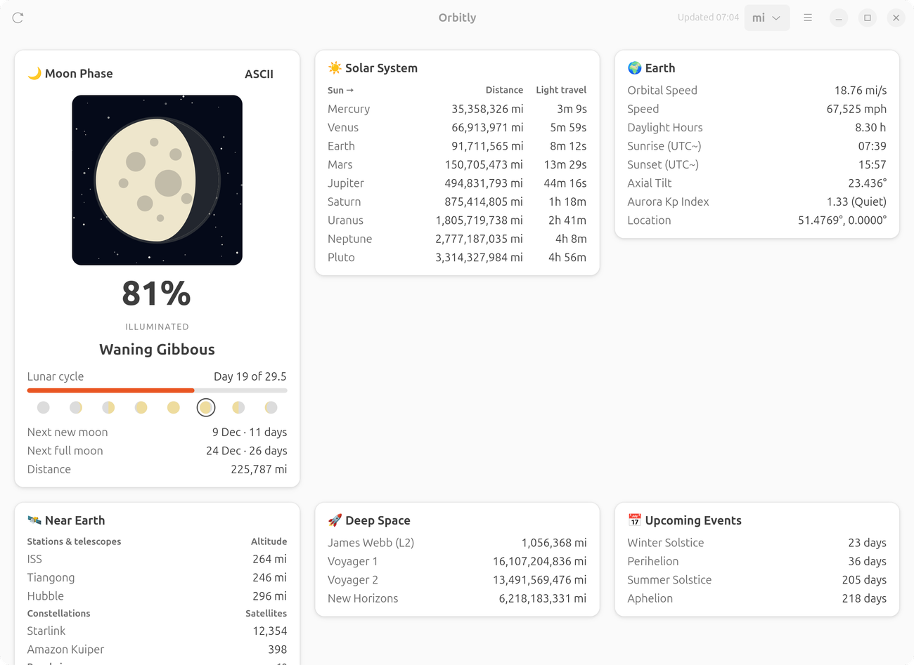

# MoonPhase for Ubuntu

A native Ubuntu desktop app (GTK4 + libadwaita, Python) ported from the
[MoonPhase](https://github.com/jamieharwood/MoonPhase) Spring Boot web dashboard.
It shows the same astronomy data, but as a desktop app instead of a server and browser.



## Features

| Card | Contents |
|---|---|
| 🌙 **Moon Phase** | Illumination %, phase name, a drawn moon with a live terminator and twinkling stars (or the original ASCII art), progress through the lunar cycle with a phase strip, the exact dates of the next new and full moon, Earth–Moon distance |
| ☀️ **Solar System** | Mercury → Pluto distance from the Sun with light travel time |
| 🌍 **Earth** | Orbital speed, daylight hours, sunrise/sunset (UTC), axial tilt, NOAA aurora Kp index, location |
| 🛰️ **Near Earth** | ISS / Tiangong / Hubble altitudes from live TLEs, Starlink and Kuiper counts, total objects in orbit, people on each spacecraft (★ = aboard the ISS) |
| 🚀 **Deep Space** | James Webb (live from JPL Horizons), Voyager 1 & 2 and New Horizons, as distances from Earth |
| 📅 **Upcoming Events** | Solstices, perihelion and aphelion, sorted by days remaining |
| 📊 **Historical Data** | Chart of any of the 35 stored metrics over 7 days to all time, CSV export, *Populate Past* backfill, reset |

Other features:

- **Units**: AU, km or miles (the header dropdown) for Solar System and Deep Space distances. Near-Earth values (the Moon, orbit altitudes, James Webb) are always in km or miles, never AU.
- **Refresh**: the button, <kbd>F5</kbd> or <kbd>Ctrl</kbd>+<kbd>R</kbd>. Calculated values update every minute. Live feeds are re-fetched every 15 minutes and at 00:01 and 12:01 UTC, as in the original. Cached results are kept (Kp for 15 minutes, James Webb for 1 hour, LEO for 6 hours).
- **Desktop notifications** for geomagnetic storms (Kp ≥ 5) and for the full moon tonight or tomorrow, at most once every 6 hours per alert.
- **Awtrix clock push** (optional): sends the same `/api/custom` metrics as the original.
- **Preferences** (<kbd>Ctrl</kbd>+<kbd>,</kbd>): location, history storage, retention, notifications, Awtrix.

## Accuracy

The calculations are the same as the web app's and are checked against
[JPL Horizons](https://ssd.jpl.nasa.gov/horizons/) by `tests/test_astro.py`, using the
same reference values:

| Quantity | Method | Typical error vs Horizons |
|---|---|---|
| Planet distances (Sun and Earth) | JPL Keplerian element tables, full 3-D Kepler solution | ≤ 0.2 % |
| Moon distance | Lunar orbit plus principal perturbations | ≤ ~600 km |
| Moon illumination / phase | True Sun–Moon elongation | < 0.1 %; new/full moon within minutes |
| Voyager 1 & 2, New Horizons | Two-body motion from Horizons state vectors (2026) | ≤ 0.02 AU, 2020–2035 |
| James Webb | Fetched live from Horizons (its L2 halo orbit can't be modelled offline) | exact; "—" when offline |
| Sunrise, sunset, day length | NOAA solar position with standard refraction | ≈ 1–2 min |

Historical snapshots (*Populate Past*) can't reconstruct James Webb, so it isn't stored.

## Install

### Requirements

Ubuntu 24.04 or newer (any desktop that has GTK4 and libadwaita ≥ 1.4):

```bash
sudo apt install python3-gi python3-cairo gir1.2-gtk-4.0 gir1.2-adw-1
```

These are already present on a standard Ubuntu 24.04 desktop.
`python3-pymongo` is only needed if you want history stored in MongoDB.

### Option 1: run from the source tree

```bash
git clone https://github.com/jamieharwood/MoonPhase-uBuntu.git
cd MoonPhase-uBuntu
./moonphase-ubuntu
```

### Option 2: per-user install (no sudo)

```bash
./install.sh            # installs to ~/.local and adds "MoonPhase" to the app grid
./install.sh --uninstall
```

### Option 3: Debian package

```bash
packaging/build-deb.sh                                  # → dist/moonphase-ubuntu_1.0.0_all.deb
sudo apt install ./dist/moonphase-ubuntu_1.0.0_all.deb
moonphase-ubuntu                                        # or launch "MoonPhase" from the app grid
```

Remove it with `sudo apt remove moonphase-ubuntu`.

## Configuration

Settings are saved in `~/.config/moonphase/config.json` and can be changed in **Preferences**.
The original app's environment variables still work and take priority:

| Variable | Default | Meaning |
|---|---|---|
| `LATITUDE` / `LONGITUDE` | `51.4769` / `0.0` (Greenwich) | Location for daylight and sunrise/sunset |
| `AWTRIXHOSTNAME` | `http://moonclock.local` | Awtrix device URL (the push itself is enabled in Preferences) |
| `SPRING_DATA_MONGODB_URI` | `mongodb://localhost:27017/moonphase` | MongoDB URI used when history storage is set to MongoDB |

### History storage

- **Local (SQLite)**, the default: `~/.local/share/moonphase/history.sqlite3`.
- **MongoDB**: writes to the `snapshots` collection using the original app's field names,
  so the web app and the desktop app can share one history database. Needs `python3-pymongo`.

As in the original, at most one snapshot is saved per 12-hour UTC window.

## Development

```bash
python3 -m unittest discover -s tests     # calculation, parser and history tests (no GTK needed)
python3 -m moonphase                      # run from the repo
```

Layout:

```
moonphase/astro.py      deterministic calculations (ported from MoonPhaseModule/*.java)
moonphase/fetchers.py   NOAA Kp, JPL Horizons (JWST), TLE API, people-in-space feeds (stdlib urllib, cached)
moonphase/history.py    SQLite / MongoDB snapshot stores, CSV, backfill
moonphase/awtrix.py     optional Awtrix push
moonphase/widgets.py    pycairo-drawn moon and history chart
moonphase/window.py     the libadwaita main window
moonphase/app.py        Adw.Application entry point
data/                   .desktop launcher, icon, AppStream metainfo
packaging/build-deb.sh  .deb builder
install.sh              per-user installer
```

### Differences from the web app

- No embedded web server, REST API, SSE or PWA. It runs as a desktop app instead.
- Requests to the TLE API are sent one at a time, because it rejects concurrent
  requests with HTTP 508.

## Licence

MIT. See [LICENSE](LICENSE).

The Barlow fonts in `store-src/`, used only to draw the store graphics, are under the
SIL Open Font License 1.1 ([store-src/FONT-LICENSE-OFL.txt](store-src/FONT-LICENSE-OFL.txt)).
